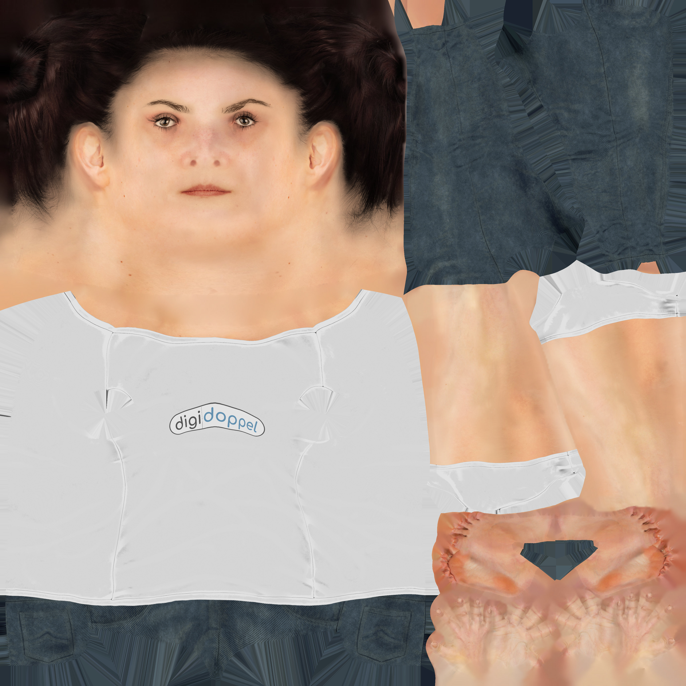
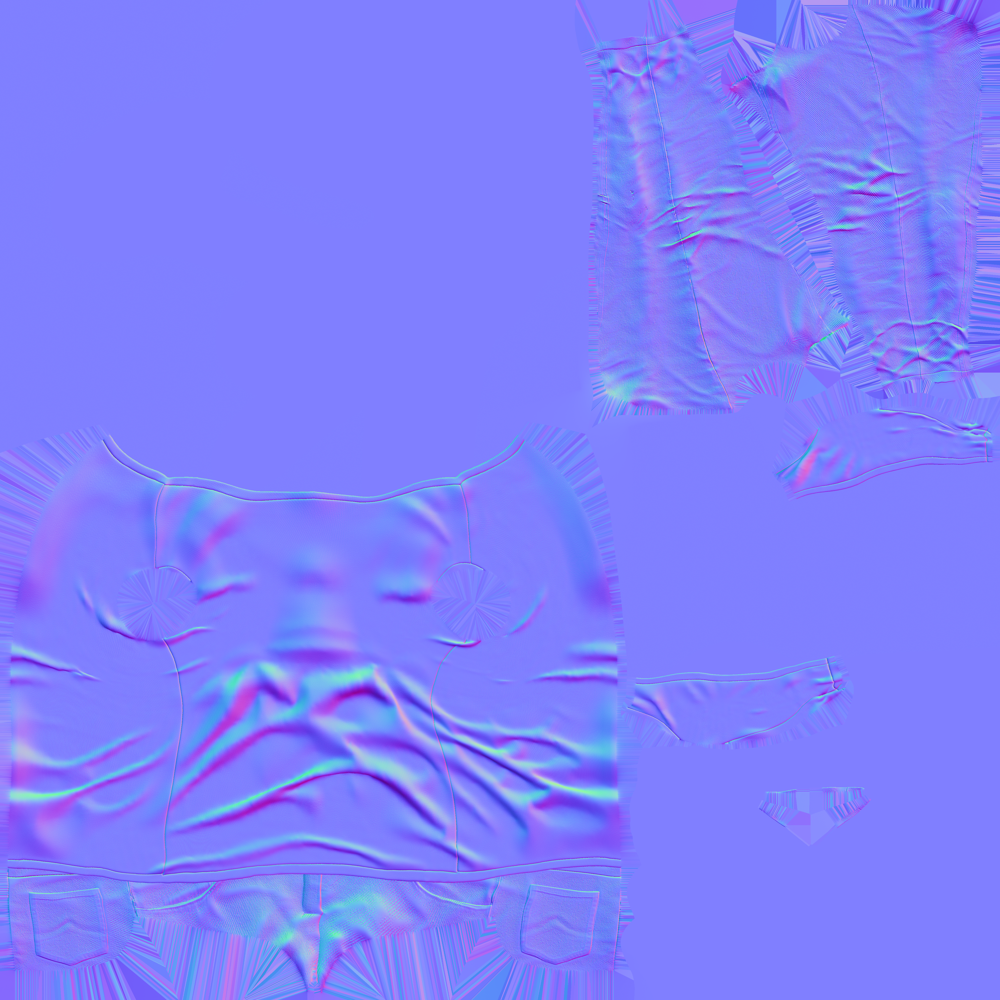

## 1 STAR人体模型

论文：STAR: Sparse Trained Articulated Human Body Regressor

官网：[STAR](https://star.is.tue.mpg.de/)  从官网下载star模型的model文件

 **STAR 1.1** ：This is the STAR model used in the ECCV2020 paper - A Sparse Trained Articulated Human Body Regressor. **We provide a male, female and neutral model with the full 300 Principal component shape space for research purposes**. 

代码：[ahmedosman/STAR: ECCV2020 - Official code repository for the paper : STAR - A Sparse Trained Articulated Human Body Regressor](https://github.com/ahmedosman/STAR)

在`config.py`代码中设置model的路径

```python
path_male_star = r"D:\OneDrive - mail.dhu.edu.cn\obsidian笔记\数字几何处理\smpl人体相关\STAR\STAR-master\star\star_1_1\male\model.npz"
path_female_star = r"D:\OneDrive - mail.dhu.edu.cn\obsidian笔记\数字几何处理\smpl人体相关\STAR\STAR-master\star\star_1_1\female\model.npz"
path_neutral_star = r"D:\OneDrive - mail.dhu.edu.cn\obsidian笔记\数字几何处理\smpl人体相关\STAR\STAR-master\star\star_1_1\neutral\model.npz"

```


## 2 star生成人体
### 2.1 初始star人体
```python
from star.pytorch.star import STAR
import numpy as np
import torch
import polyscope as ps

np.set_printoptions(suppress=True)

batch_size = 1
num_betas = 300  # 设置使用多少个主成分10 20 300
poses = torch.cuda.FloatTensor(np.zeros((batch_size, 72)))
betas = torch.cuda.FloatTensor(np.zeros((batch_size, num_betas)))
trans = torch.cuda.FloatTensor(np.zeros((batch_size, 3)))

star = STAR(gender='female', num_betas=num_betas)
model = star.forward(poses, betas, trans)
v = model[0].cpu().numpy()
f = model.f.astype("int32")

ps.init()
ps.register_surface_mesh("mesh", v, f,
                         color=np.array([0, 91, 255]) / 255,
                         edge_width=0.001,
                         edge_color=[1, 1, 1],
                         smooth_shade=True,
                         # material="flat"
                         )

ps.set_build_gui(False)
ps.set_view_projection_mode("perspective")  # orthographic 正交投影   perspective 透视投影
# ps.set_navigation_style("planar")  # ['turntable','free','planar','none','first_person']
ps.set_ground_plane_mode("shadow_only")  # ['none','tile','tile_reflection','shadow_only']
# ps.set_ground_plane_height(-0.001)  # 设置地平面高度
ps.set_shadow_blur_iters(3)  # 设置地平面阴影模糊程度
ps.set_shadow_darkness(0.5)  # 设置地平面阴影明暗程度
ps.set_up_dir("y_up")  # 设置y轴正方向向上（这个和设置视角会冲突，因此在添加视角参数时，这一行要注释掉）
ps.set_front_dir('z_front')  # 设置z轴正方向向前
ps.set_SSAA_factor(4)  # 在截图时，设置为4时，截图会更清晰
ps.show()

```


### 2.2 调整姿态
STAR人体的拓扑和关节点设置和SMPL人体是一样的

STAR人体（SMPL人体）6890个顶点、13776个面、24个关节（72个姿态参数）

```python
from star.pytorch.star import STAR  
import numpy as np  
import torch  
import polyscope as ps  
  
np.set_printoptions(suppress=True)  
  
batch_size = 1  
num_betas = 300  # 设置使用多少个主成分10 20 300  
  
np_poses = np.zeros((1, 72))  
  
# 1、通过旋转角度来设置姿态参数  
# np_poses[0, 3 * 16 + 2] = np.deg2rad(-45)  # 左臂  
# np_poses[0, 3 * 17 + 2] = np.deg2rad(45)  # 右臂  
  
# np.deg2rad()这个函数，将角度制（degrees）转换为弧度制（radians）  
# print(np.deg2rad(-45))  # -0.7853981633974483  
# print(np.deg2rad(45))  # 0.7853981633974483  
  
# 2、也可以直接设置数值  
# A姿态  
np_poses[0, 3 * 16 + 2] = -0.8  
np_poses[0, 3 * 17 + 2] = 0.8  
np_poses[:, 3 * 1 + 2] = 0.1  # 右脚  
np_poses[:, 3 * 2 + 2] = -0.1  # 左脚  
np_poses[0, 3 * 13 + 2] = -0.2  # 左锁骨  
np_poses[0, 3 * 14 + 2] = 0.2  # 右锁骨  
  
poses = torch.cuda.FloatTensor(np_poses)  
betas = torch.cuda.FloatTensor(np.zeros((batch_size, num_betas)))  
trans = torch.cuda.FloatTensor(np.zeros((batch_size, 3)))  
  
star = STAR(gender='female', num_betas=num_betas)  
model = star.forward(poses, betas, trans)  
v = model[0].cpu().numpy()  
f = model.f.astype("int32")  
  
print(f.shape)  
  
ps.init()  
ps.register_surface_mesh("mesh", v, f,  
                         color=np.array([0, 91, 255]) / 255,  
                         edge_width=0.001,  
                         edge_color=[1, 1, 1],  
                         smooth_shade=True,  
                         # material="flat"  
                         )  
  
ps.set_build_gui(False)  
ps.set_view_projection_mode("perspective")  # orthographic 正交投影   perspective 透视投影  
# ps.set_navigation_style("planar")  # ['turntable','free','planar','none','first_person']  
ps.set_ground_plane_mode("shadow_only")  # ['none','tile','tile_reflection','shadow_only']  
# ps.set_ground_plane_height(-0.001)  # 设置地平面高度  
ps.set_shadow_blur_iters(3)  # 设置地平面阴影模糊程度  
ps.set_shadow_darkness(0.5)  # 设置地平面阴影明暗程度  
ps.set_up_dir("y_up")  # 设置y轴正方向向上（这个和设置视角会冲突，因此在添加视角参数时，这一行要注释掉）  
ps.set_front_dir('z_front')  # 设置z轴正方向向前  
ps.set_SSAA_factor(4)  # 在截图时，设置为4时，截图会更清晰  
ps.show()

```


```python
# 每个关节都可以绕x、y、z轴旋转
np_poses[0, 3 * 16 + 0] = np.deg2rad(-45) # 第16个关节绕x轴旋转-45度
np_poses[0, 3 * 16 + 1] = np.deg2rad(30) # 第16个关节绕y轴旋转30度
np_poses[0, 3 * 16 + 2] = np.deg2rad(20) # 第16个关节绕z轴旋转20度
```

注意理解：13和14、16和17关节调整的区别

| 关节    | 典型旋转效果         | 重点观察区域    |
| ----- | -------------- | --------- |
| 13左锁骨 | 左肩带抬起、下沉或前后调整  | 左侧颈肩、肩峰附近 |
| 14右锁骨 | 右肩带抬起、下沉或前后调整  | 右侧颈肩、肩峰附近 |
| 16左肩  | 左上臂抬起、外展、前摆、后摆 | 左上臂、腋下、袖窿 |
| 17右肩  | 右上臂抬起、外展、前摆、后摆 | 右上臂、腋下、袖窿 |


### 2.3 生成随机人体
```python
from star.pytorch.star import STAR
import numpy as np
import torch
import polyscope as ps

np.set_printoptions(suppress=True)

batch_size = 1
num_betas = 300  # 设置使用多少个主成分
np_betas = np.random.uniform(-1.5, 1.5, (batch_size, num_betas))  # 随机shape参数
betas = torch.cuda.FloatTensor(np_betas)

poses = torch.cuda.FloatTensor(np.zeros((batch_size, 72)))
trans = torch.cuda.FloatTensor(np.zeros((batch_size, 3)))

star = STAR(gender='female', num_betas=num_betas)
model = star.forward(poses, betas, trans)
v = model[0].cpu().numpy()
f = model.f.astype("int32")

ps.init()
ps.register_surface_mesh("mesh", v, f,
                         color=np.array([0, 91, 255]) / 255,
                         edge_width=0.001,
                         edge_color=[1, 1, 1],
                         smooth_shade=True,
                         # material="flat"
                         )

ps.set_build_gui(False)
ps.set_view_projection_mode("perspective")  # orthographic 正交投影   perspective 透视投影
# ps.set_navigation_style("planar")  # ['turntable','free','planar','none','first_person']
ps.set_ground_plane_mode("shadow_only")  # ['none','tile','tile_reflection','shadow_only']
# ps.set_ground_plane_height(-0.001)  # 设置地平面高度
ps.set_shadow_blur_iters(3)  # 设置地平面阴影模糊程度
ps.set_shadow_darkness(0.5)  # 设置地平面阴影明暗程度
ps.set_up_dir("y_up")  # 设置y轴正方向向上（这个和设置视角会冲突，因此在添加视角参数时，这一行要注释掉）
ps.set_front_dir('z_front')  # 设置z轴正方向向前
ps.set_SSAA_factor(4)  # 在截图时，设置为4时，截图会更清晰
ps.show()

```

### 2.4 可视化star人体关节

```python
from star.pytorch.star import STAR
import numpy as np
import torch
import polyscope as ps

np.set_printoptions(suppress=True)

batch_size = 1
num_betas = 300  # 设置使用多少个主成分10 20 300

poses = torch.cuda.FloatTensor(np.zeros((batch_size, 72)))
betas = torch.cuda.FloatTensor(np.zeros((batch_size, num_betas)))
trans = torch.cuda.FloatTensor(np.zeros((batch_size, 3)))

star = STAR(gender='female', num_betas=num_betas)
model = star.forward(poses, betas, trans)
v = model[0].cpu().numpy()
f = model.f.astype("int32")

# 加载模型文件
path_female_star = r"D:\OneDrive - mail.dhu.edu.cn\obsidian笔记\数字几何处理\smpl人体相关\STAR\STAR-master\star\star_1_1\female\model.npz"
model_dict = np.load(path_female_star, allow_pickle=True)

# J_regressor 骨骼旋转矩阵J_regressor @ v，根据人体顶点可求得关节点位置
J_regressor = model_dict["J_regressor"]
star_joints = J_regressor @ v

star_bone = np.array([[0, 3],
                      [3, 6],
                      [6, 9],
                      [9, 13],
                      [13, 16],
                      [16, 18],
                      [18, 20],
                      [20, 22],
                      [9, 14],
                      [14, 17],
                      [17, 19],
                      [19, 21],
                      [21, 23],
                      [0, 1],
                      [1, 4],
                      [4, 7],
                      [7, 10],
                      [0, 2],
                      [2, 5],
                      [5, 8],
                      [8, 11],
                      [9, 12],
                      [12, 15]])

ps.init()
ps.register_surface_mesh("mesh", v, f,
                         color=np.array([0, 91, 255]) / 255,
                         edge_width=0.001,
                         edge_color=[1, 1, 1],
                         smooth_shade=True,
                         transparency=0.5
                         # material="flat"
                         )

ps_joints = ps.register_point_cloud("j", star_joints, radius=0.005, color=[1, 0, 0])
ps_bone = ps.register_curve_network("bone", star_joints, star_bone, radius=0.0015,
                                    color=np.array([255, 0, 218]) / 255)

ps.set_build_gui(False)
ps.set_view_projection_mode("perspective")  # orthographic 正交投影   perspective 透视投影
# ps.set_navigation_style("planar")  # ['turntable','free','planar','none','first_person']
ps.set_ground_plane_mode("shadow_only")  # ['none','tile','tile_reflection','shadow_only']
# ps.set_ground_plane_height(-0.001)  # 设置地平面高度
ps.set_shadow_blur_iters(3)  # 设置地平面阴影模糊程度
ps.set_shadow_darkness(0.5)  # 设置地平面阴影明暗程度
ps.set_up_dir("y_up")  # 设置y轴正方向向上（这个和设置视角会冲突，因此在添加视角参数时，这一行要注释掉）
ps.set_front_dir('z_front')  # 设置z轴正方向向前
ps.set_SSAA_factor(4)  # 在截图时，设置为4时，截图会更清晰
ps.show()

```


### 2.5 加载star人体model文件

```python
import numpy as np

np.set_printoptions(suppress=True)

path_female_star = r"D:\OneDrive - mail.dhu.edu.cn\obsidian笔记\数字几何处理\smpl人体相关\STAR\STAR-master\star\star_1_1\female\model.npz"
model_dict = np.load(path_female_star, allow_pickle=True)

for key in model_dict.files:
    value = model_dict[key]

    if isinstance(value, np.ndarray):
        print(f"{key:30s} shape={value.shape}, dtype={value.dtype}")
    else:
        print(f"{key:30s} type={type(value)}")

f = model_dict['f']
J_regressor = model_dict['J_regressor']  # Regressor of the model
kintree_table = model_dict['kintree_table']
weights = model_dict['weights']  # Weights
posedirs = model_dict['posedirs']
v_tempalate = model_dict['v_template']
shapedirs = np.array(model_dict['shapedirs'])  # Shape Corrective Blend shapes

```

打印：
```python
f                              shape=(13776, 3), dtype=uint32
J_regressor                    shape=(24, 6890), dtype=float64
kintree_table                  shape=(2, 24), dtype=uint32
weights                        shape=(6890, 24), dtype=float64
posedirs                       shape=(6890, 3, 93), dtype=float64
v_template                     shape=(6890, 3), dtype=float64
shapedirs                      shape=(6890, 3, 300), dtype=float64
```

### 2.6 可视化蒙皮权重 

```python
import numpy as np
import torch
import polyscope as ps

from star.pytorch.star import STAR

# ==================== 1. 生成 STAR 人体 ====================
device = torch.device("cuda" if torch.cuda.is_available() else "cpu")

star = STAR(gender="female", num_betas=10).to(device)

pose = torch.zeros((1, 72), device=device)
betas = torch.zeros((1, 10), device=device)
trans = torch.zeros((1, 3), device=device)

with torch.no_grad():
    model = star(pose, betas, trans)

v = model[0].cpu().numpy()
f = model.f.astype(np.int32)

# ==================== 2. 加载全部蒙皮权重 ====================
path_female_star = (
    r"D:\OneDrive - mail.dhu.edu.cn\obsidian笔记"
    r"\数字几何处理\smpl人体相关\STAR\STAR-master"
    r"\star\star_1_1\female\model.npz"
)

model_dict = np.load(path_female_star, allow_pickle=True)

# (6890, 24)
weights = model_dict["weights"]

# 每个顶点权重最大的关节
dominant_joint = np.argmax(weights, axis=1)

# 对应的最大权重，用于表示影响强弱
dominant_weight = np.max(weights, axis=1)

joint_names = [
    "Pelvis", "L_Hip", "R_Hip", "Spine1",
    "L_Knee", "R_Knee", "Spine2", "L_Ankle",
    "R_Ankle", "Spine3", "L_Foot", "R_Foot",
    "Neck", "L_Collar", "R_Collar", "Head",
    "L_Shoulder", "R_Shoulder", "L_Elbow", "R_Elbow",
    "L_Wrist", "R_Wrist", "L_Hand", "R_Hand"
]

# 为 24 个关节生成不同颜色
import matplotlib.pyplot as plt

cmap = plt.get_cmap("hsv", 24)
joint_colors = np.array([cmap(i)[:3] for i in range(24)])

# 顶点颜色 = 主要影响关节的颜色
vertex_colors = joint_colors[dominant_joint]

# 用最大权重控制颜色明暗
# 权重越大，颜色越鲜明；权重越小，颜色越接近灰色
strength = np.clip(dominant_weight, 0, 1)
vertex_colors = (
        vertex_colors * strength[:, None]
        + np.array([0.65, 0.65, 0.65]) * (1 - strength[:, None])
)

# ==================== 3. 可视化全部关节 ====================
ps.init()

mesh = ps.register_surface_mesh(
    "STAR Skinning Weights",
    v,
    f,
    smooth_shade=True,
    edge_width=0.0
)

mesh.add_color_quantity(
    "Dominant Joint Colors",
    vertex_colors,
    defined_on="vertices",
    enabled=True
)

# 同时保留最大权重标量，方便检查权重强弱
mesh.add_scalar_quantity(
    "Dominant Weight",
    dominant_weight,
    defined_on="vertices",
    enabled=False
)

ps.set_up_dir("y_up")
ps.set_ground_plane_mode("shadow_only")
ps.set_SSAA_factor(4)

ps.show()

```


|              Dominant Joint Colors              |                 Dominant Weight                 |
| :---------------------------------------------: | :---------------------------------------------: |
|  |  |

### 2.7 可视化蒙皮权重-方法2

配色参考这个代码：
https://github.com/PeizhuoLi/neural-blend-shapes

```python
from star.pytorch.star import STAR
import numpy as np
import torch
import polyscope as ps
import random
import colorsys

np.set_printoptions(suppress=True)


# 这个函数是我添加的，用于将颜色调亮，可视化效果更好
def brighten_rgb_hsv(rgb_colors, value_factor=1.5):
    """
    使用 HSV 空间提亮颜色（调整 Value）
    """
    brightened = []
    for r, g, b in rgb_colors:
        h, s, v = colorsys.rgb_to_hsv(r, g, b)
        v_new = min(1.0, v * value_factor)  # 提高亮度，上限为 1.0
        r_new, g_new, b_new = colorsys.hsv_to_rgb(h, s, v_new)
        brightened.append([r_new, g_new, b_new])
    return np.array(brightened)


def generate_color_table(num_colors):
    """
    Generate num_colors of colors from matplotlib's tableau colors (saved as npy), repeat if necessary
    @param num_colors: int, number of colors needed
    @return: rgb, (num_colors, 3)
    """
    base_colors = np.load('./tableau_color.npy')
    # 应用提亮（增大factor的值，将颜色调亮，，值太大并不好，有些颜色会泛白）
    base_colors = brighten_rgb_hsv(base_colors, value_factor=1.3)

    # print(base_colors)
    # print(base_colors.shape) 20*3

    idx = list(range(base_colors.shape[0]))
    random.seed(5)
    random.shuffle(idx)
    pt = 0
    res = []
    for i in range(num_colors):
        res.append(base_colors[idx[pt]])
        pt += 1
        pt %= base_colors.shape[0]
    return np.array(res)


def weight2color(weight):
    n_color = weight.shape[1]
    colors = generate_color_table(n_color)
    res = np.matmul(weight, colors)
    # Ensure colors are in [0, 1]
    res = np.clip(res, 0.0, 1.0)
    return res


batch_size = 1
num_betas = 300  # 设置使用多少个主成分10 20 300

poses = torch.cuda.FloatTensor(np.zeros((batch_size, 72)))
betas = torch.cuda.FloatTensor(np.zeros((batch_size, num_betas)))
trans = torch.cuda.FloatTensor(np.zeros((batch_size, 3)))

star = STAR(gender='female', num_betas=num_betas)
model = star.forward(poses, betas, trans)
v = model[0].cpu().numpy()
f = model.f.astype("int32")

# 加载模型文件
path_female_star = r"D:\OneDrive - mail.dhu.edu.cn\obsidian笔记\数字几何处理\smpl人体相关\STAR\STAR-master\star\star_1_1\female\model.npz"
model_dict = np.load(path_female_star, allow_pickle=True)

# (6890, 24)
weights = model_dict["weights"]

vertex_colors = weight2color(weights)  # shape: (V, 3)

ps.init()
ps_mesh = ps.register_surface_mesh("mesh", v, f,
                                   color=np.array([0, 91, 255]) / 255,
                                   edge_width=0.001,
                                   edge_color=[1, 1, 1],
                                   smooth_shade=True,
                                   # material="flat"
                                   )

ps_mesh.add_color_quantity("Skinning Weights", vertex_colors,
                           defined_on='vertices',
                           enabled=True)

ps.set_build_gui(False)
ps.set_view_projection_mode("perspective")  # orthographic 正交投影   perspective 透视投影
# ps.set_navigation_style("planar")  # ['turntable','free','planar','none','first_person']
ps.set_ground_plane_mode("shadow_only")  # ['none','tile','tile_reflection','shadow_only']
# ps.set_ground_plane_height(-0.001)  # 设置地平面高度
ps.set_shadow_blur_iters(3)  # 设置地平面阴影模糊程度
ps.set_shadow_darkness(0.5)  # 设置地平面阴影明暗程度
ps.set_up_dir("y_up")  # 设置y轴正方向向上（这个和设置视角会冲突，因此在添加视角参数时，这一行要注释掉）
ps.set_front_dir('z_front')  # 设置z轴正方向向前
ps.set_SSAA_factor(4)  # 在截图时，设置为4时，截图会更清晰
ps.show()

```


|                     没有将颜色提亮                     |                      将颜色提亮                      |
| :---------------------------------------------: | :---------------------------------------------: |
|  |  |

### 2.8 cuda加速
**方法1**：将star模型和参数都添加device

```python
if torch.cuda.is_available():
    device = torch.device("cuda:0")
else:
    device = torch.device("cpu")
    print("WARNING: CPU only, this will be slow!")
    

star = STAR(gender="female", num_betas=10).to(device)

pose = torch.zeros((1, 72), device=device)  
betas = torch.zeros((1, 10), device=device)  
trans = torch.zeros((1, 3), device=device)  
  
model = star(pose, betas, trans)

v = model[0].cpu().numpy()  
f = model.f.astype(np.int32)
```

**方法2**：只给参数设置device

在STAR模型的内部，device是根据pose获得的

也就是说，如果pose参数是GPU向量，就使用了cuda加速

```python

# star = STAR(gender='female',num_betas=num_betas)
# device = pose.device

batch_size = 1
num_betas = 300  # 设置使用多少个主成分10 20 300
poses = torch.cuda.FloatTensor(np.zeros((batch_size, 72)))
betas = torch.cuda.FloatTensor(np.zeros((batch_size, num_betas)))
trans = torch.cuda.FloatTensor(np.zeros((batch_size, 3)))

star = STAR(gender='female', num_betas=num_betas)
model = star.forward(poses, betas, trans)
v = model[0].cpu().numpy()
f = model.f.astype("int32")
```

## 3 star人体分区
下载star人体分区顶点索引文件
[smpl_vert_segmentation.json](https://github.com/Meshcapade/wiki/blob/main/assets/SMPL_body_segmentation/smpl/smpl_vert_segmentation.json)

### 3.1 可视化star人体分区
```python
from star.pytorch.star import STAR
import numpy as np
import torch
import polyscope as ps
import json

np.set_printoptions(suppress=True)

# 1、初始化star人体
batch_size = 1
num_betas = 300  # 设置使用多少个主成分10 20 300

# T姿态
# poses = torch.cuda.FloatTensor(np.zeros((batch_size, 72)))

# A姿态
A_pose_np = np.zeros((1, 72))
A_pose_np[:, 3 * 1 + 2] = 0.1  # 右脚
A_pose_np[:, 3 * 2 + 2] = -0.1  # 左脚
A_pose_np[0, 3 * 13 + 2] = -0.2  # 左手
A_pose_np[0, 3 * 14 + 2] = 0.2  # 右手
A_pose_np[0, 3 * 16 + 2] = -0.8  # 左臂
A_pose_np[0, 3 * 17 + 2] = 0.8  # 右臂

poses = torch.cuda.FloatTensor(A_pose_np)
betas = torch.cuda.FloatTensor(np.zeros((batch_size, num_betas)))
trans = torch.cuda.FloatTensor(np.zeros((batch_size, 3)))

# 使用姿态参数poses、体形参数betas和平移向量trans，生成star人体
star = STAR(gender='female', num_betas=num_betas)
model = star.forward(poses, betas, trans)
V = model[0].cpu().numpy()
F = model.f.astype("int32")

with open('smpl_vert_segmentation.json') as fin:
    vertex_groups = json.load(fin)

ps.init()
ps.set_window_size(1200,800)
ps.register_surface_mesh("mesh", V, F, color=np.array([0, 91, 255]) / 255,
                         edge_color=[1, 1, 1], edge_width=0.1)

r = 0.003
ps.register_point_cloud("rightHand", V[vertex_groups['rightHand']], radius=r)
ps.register_point_cloud("rightUpLeg", V[vertex_groups['rightUpLeg']], radius=r)
ps.register_point_cloud("leftArm ", V[vertex_groups['leftArm']], radius=r)
ps.register_point_cloud("leftLeg", V[vertex_groups['leftLeg']], radius=r)
ps.register_point_cloud("leftToeBase", V[vertex_groups['leftToeBase']], radius=r)
ps.register_point_cloud("leftFoot", V[vertex_groups['leftFoot']], radius=r)
ps.register_point_cloud("spine1", V[vertex_groups['spine1']], radius=r)
ps.register_point_cloud("spine2", V[vertex_groups['spine2']], radius=r)
ps.register_point_cloud("leftShoulder", V[vertex_groups['leftShoulder']], radius=r)
ps.register_point_cloud("rightShoulder", V[vertex_groups['rightShoulder']], radius=r)
ps.register_point_cloud("rightFoot ", V[vertex_groups['rightFoot']], radius=r)
ps.register_point_cloud("head", V[vertex_groups['head']], radius=r)
ps.register_point_cloud("rightArm", V[vertex_groups['rightArm']], radius=r)
ps.register_point_cloud("leftHandIndex1", V[vertex_groups['leftHandIndex1']], radius=r)
ps.register_point_cloud("rightLeg", V[vertex_groups['rightLeg']], radius=r)
ps.register_point_cloud("rightHandIndex1", V[vertex_groups['rightHandIndex1']], radius=r)
ps.register_point_cloud("leftForeArm", V[vertex_groups['leftForeArm']], radius=r)
ps.register_point_cloud("rightForeArm", V[vertex_groups['rightForeArm']], radius=r)
ps.register_point_cloud("neck", V[vertex_groups['neck']], radius=r)
ps.register_point_cloud("rightToeBase", V[vertex_groups['rightToeBase']], radius=r)
ps.register_point_cloud("spine", V[vertex_groups['spine']], radius=r)
ps.register_point_cloud("leftUpLeg", V[vertex_groups['leftUpLeg']], radius=r)
ps.register_point_cloud("leftHand", V[vertex_groups['leftHand']], radius=r)
ps.register_point_cloud("hips", V[vertex_groups['hips']], radius=r)

# ps.set_build_gui(False)
ps.set_view_projection_mode("perspective")  # orthographic 正交投影   perspective 透视投影
# ps.set_navigation_style("planar")  # ['turntable','free','planar','none','first_person']
ps.set_ground_plane_mode("shadow_only")  # ['none','tile','tile_reflection','shadow_only']
# ps.set_ground_plane_height(-0.001)  # 设置地平面高度
ps.set_shadow_blur_iters(3)  # 设置地平面阴影模糊程度
ps.set_shadow_darkness(0.5)  # 设置地平面阴影明暗程度
ps.set_up_dir("y_up")  # 设置y轴正方向向上（这个和设置视角会冲突，因此在添加视角参数时，这一行要注释掉）
ps.set_front_dir('z_front')  # 设置z轴正方向向前
ps.set_SSAA_factor(4)  # 在截图时，设置为4时，截图会更清晰
ps.show()

```


### 3.2 可视化star人体分区-简化版

```python
from star.pytorch.star import STAR
import numpy as np
import torch
import polyscope as ps
import json

np.set_printoptions(suppress=True)

# 1、初始化star人体
batch_size = 1
num_betas = 300  # 设置使用多少个主成分10 20 300

# T姿态
# poses = torch.cuda.FloatTensor(np.zeros((batch_size, 72)))

# A姿态
A_pose_np = np.zeros((1, 72))
A_pose_np[:, 3 * 1 + 2] = 0.1  # 右脚
A_pose_np[:, 3 * 2 + 2] = -0.1  # 左脚
A_pose_np[0, 3 * 13 + 2] = -0.2  # 左手
A_pose_np[0, 3 * 14 + 2] = 0.2  # 右手
A_pose_np[0, 3 * 16 + 2] = -0.8  # 左臂
A_pose_np[0, 3 * 17 + 2] = 0.8  # 右臂

poses = torch.cuda.FloatTensor(A_pose_np)
betas = torch.cuda.FloatTensor(np.zeros((batch_size, num_betas)))
trans = torch.cuda.FloatTensor(np.zeros((batch_size, 3)))

# 使用姿态参数poses、体形参数betas和平移向量trans，生成star人体
star = STAR(gender='female', num_betas=num_betas)
model = star.forward(poses, betas, trans)
V = model[0].cpu().numpy()
F = model.f.astype("int32")

with open('smpl_vert_segmentation.json') as fin:
    vertex_groups = json.load(fin)

print(type(vertex_groups))
print(vertex_groups.keys())

ps.init()
ps.set_window_size(1200, 800)
ps.register_surface_mesh("mesh", V, F, color=np.array([0, 91, 255]) / 255,
                         edge_color=[1, 1, 1], edge_width=0.1)

r = 0.003

for k in vertex_groups.keys():
    ps.register_point_cloud("{}".format(k), V[vertex_groups[k]], radius=r)

# ps.set_build_gui(False)
ps.set_view_projection_mode("perspective")  # orthographic 正交投影   perspective 透视投影
# ps.set_navigation_style("planar")  # ['turntable','free','planar','none','first_person']
ps.set_ground_plane_mode("shadow_only")  # ['none','tile','tile_reflection','shadow_only']
# ps.set_ground_plane_height(-0.001)  # 设置地平面高度
ps.set_shadow_blur_iters(3)  # 设置地平面阴影模糊程度
ps.set_shadow_darkness(0.5)  # 设置地平面阴影明暗程度
ps.set_up_dir("y_up")  # 设置y轴正方向向上（这个和设置视角会冲突，因此在添加视角参数时，这一行要注释掉）
ps.set_front_dir('z_front')  # 设置z轴正方向向前
ps.set_SSAA_factor(4)  # 在截图时，设置为4时，截图会更清晰
ps.show()

```

打印：
```python
<class 'dict'>
dict_keys(['rightHand', 'rightUpLeg', 'leftArm', 'leftLeg', 'leftToeBase', 'leftFoot', 'spine1', 'spine2', 'leftShoulder', 'rightShoulder', 'rightFoot', 'head', 'rightArm', 'leftHandIndex1', 'rightLeg', 'rightHandIndex1', 'leftForeArm', 'rightForeArm', 'neck', 'rightToeBase', 'spine', 'leftUpLeg', 'leftHand', 'hips'])
```

### 3.3 组合分区顶点

```python
from star.pytorch.star import STAR
import numpy as np
import torch
import polyscope as ps
import json

np.set_printoptions(suppress=True)

# 1、初始化star人体
batch_size = 1
num_betas = 300  # 设置使用多少个主成分10 20 300

# T姿态
# poses = torch.cuda.FloatTensor(np.zeros((batch_size, 72)))

# A姿态
A_pose_np = np.zeros((1, 72))
A_pose_np[:, 3 * 1 + 2] = 0.1  # 右脚
A_pose_np[:, 3 * 2 + 2] = -0.1  # 左脚
A_pose_np[0, 3 * 13 + 2] = -0.2  # 左手
A_pose_np[0, 3 * 14 + 2] = 0.2  # 右手
A_pose_np[0, 3 * 16 + 2] = -0.8  # 左臂
A_pose_np[0, 3 * 17 + 2] = 0.8  # 右臂

poses = torch.cuda.FloatTensor(A_pose_np)
betas = torch.cuda.FloatTensor(np.zeros((batch_size, num_betas)))
trans = torch.cuda.FloatTensor(np.zeros((batch_size, 3)))

# 使用姿态参数poses、体形参数betas和平移向量trans，生成star人体
star = STAR(gender='female', num_betas=num_betas)
model = star.forward(poses, betas, trans)
V = model[0].cpu().numpy()
F = model.f.astype("int32")

with open('smpl_vert_segmentation.json') as fin:
    vertex_groups = json.load(fin)

ps.init()
ps.register_surface_mesh("smpl", V, F, color=np.array([0, 91, 255]) / 255,
                         edge_color=[1, 1, 1], edge_width=0.1)

r = 0.004

# 头和颈
head_and_neck_id = vertex_groups["head"] + vertex_groups["neck"]
ps.register_point_cloud("head_and_neck", V[head_and_neck_id], radius=r, color=[100 / 255, 0, 255 / 255])

# 身体
main_body_id = (
        vertex_groups['rightShoulder'] +
        vertex_groups['leftShoulder'] +
        vertex_groups["spine2"] +
        vertex_groups['spine1'] +
        vertex_groups['spine'] +
        vertex_groups['hips'] +
        vertex_groups['rightUpLeg'] +
        vertex_groups['leftUpLeg'] +
        vertex_groups['rightLeg'] +
        vertex_groups['leftLeg'])
ps.register_point_cloud("main_body", V[main_body_id], radius=r, color=[255 / 255, 164 / 255, 0])

# 右手
rightArm_and_hand_id = (vertex_groups["rightArm"] +
                        vertex_groups["rightForeArm"] +
                        vertex_groups["rightHand"] +
                        vertex_groups["rightHandIndex1"])
ps.register_point_cloud("rightArm_and_hand", V[rightArm_and_hand_id], radius=r, color=[0, 255 / 255, 37 / 255])

# 左手
leftArm_and_hand_id = (vertex_groups["leftArm"] +
                       vertex_groups["leftForeArm"] +
                       vertex_groups["leftHand"] +
                       vertex_groups["leftHandIndex1"])
ps.register_point_cloud("leftArm_and_hand", V[leftArm_and_hand_id], radius=r, color=[0, 255 / 255, 228 / 255])

# 右脚
right_foot_id = vertex_groups['rightFoot'] + vertex_groups['rightToeBase']
ps.register_point_cloud("right_foot", V[right_foot_id], radius=r, color=[0, 255 / 255, 37 / 255])

# 左脚
left_foot_id = vertex_groups['leftFoot'] + vertex_groups['leftToeBase']
ps.register_point_cloud("left_foot", V[left_foot_id], radius=r, color=[0, 255 / 255, 228 / 255])

# 右腿
right_leg_id = vertex_groups['rightUpLeg'] + vertex_groups['rightFoot'] + vertex_groups['rightToeBase'] + vertex_groups[
    'rightLeg']
ps.register_point_cloud("right_leg", V[right_leg_id], radius=r, color=[255 / 255, 0, 27 / 255])

# 腰到膝盖
spine_to_upleg_id = vertex_groups['rightUpLeg'] + vertex_groups['leftUpLeg'] + vertex_groups['hips'] + vertex_groups[
    'spine']
ps.register_point_cloud("spine_to_upleg", V[spine_to_upleg_id], radius=r, color=[255 / 255, 255 / 255, 0])

# ps.set_build_gui(False)
ps.set_window_size(1200, 800)
ps.set_view_projection_mode("perspective")  # orthographic 正交投影   perspective 透视投影
# ps.set_navigation_style("planar")  # ['turntable','free','planar','none','first_person']
ps.set_ground_plane_mode("shadow_only")  # ['none','tile','tile_reflection','shadow_only']
# ps.set_ground_plane_height(-0.001)  # 设置地平面高度
ps.set_shadow_blur_iters(3)  # 设置地平面阴影模糊程度
ps.set_shadow_darkness(0.5)  # 设置地平面阴影明暗程度
ps.set_up_dir("y_up")  # 设置y轴正方向向上（这个和设置视角会冲突，因此在添加视角参数时，这一行要注释掉）
ps.set_front_dir('z_front')  # 设置z轴正方向向前
ps.set_SSAA_factor(4)  # 在截图时，设置为4时，截图会更清晰
ps.show()

```

|  |  |
| :---------------------------------------------: | :---------------------------------------------: |
|                      拟合头部                       |                  方便测量胸围、腰围、臀围                   |
|  |  |
|                      拟合手部                       |                      拟合手部                       |
|  |  |
|                      拟合脚部                       |                      拟合脚部                       |
|  |  |
|                     拟合腰臀腿区域                     |                 方便测量大腿围、膝围、脚腕围等                 |

### 3.4 区域顶点有重叠
```python
from star.pytorch.star import STAR
import numpy as np
import torch
import polyscope as ps
import json

np.set_printoptions(suppress=True)

# 1、初始化star人体
batch_size = 1
num_betas = 300  # 设置使用多少个主成分10 20 300

# T姿态
# poses = torch.cuda.FloatTensor(np.zeros((batch_size, 72)))

# A姿态
A_pose_np = np.zeros((1, 72))
A_pose_np[:, 3 * 1 + 2] = 0.1  # 右脚
A_pose_np[:, 3 * 2 + 2] = -0.1  # 左脚
A_pose_np[0, 3 * 13 + 2] = -0.2  # 左手
A_pose_np[0, 3 * 14 + 2] = 0.2  # 右手
A_pose_np[0, 3 * 16 + 2] = -0.8  # 左臂
A_pose_np[0, 3 * 17 + 2] = 0.8  # 右臂

poses = torch.cuda.FloatTensor(A_pose_np)
betas = torch.cuda.FloatTensor(np.zeros((batch_size, num_betas)))
trans = torch.cuda.FloatTensor(np.zeros((batch_size, 3)))

# 使用姿态参数poses、体形参数betas和平移向量trans，生成star人体
star = STAR(gender='female', num_betas=num_betas)
model = star.forward(poses, betas, trans)
V = model[0].cpu().numpy()
F = model.f.astype("int32")

with open('smpl_vert_segmentation.json') as fin:
    vertex_groups = json.load(fin)

ps.init()
ps.register_surface_mesh("smpl", V, F, color=np.array([0, 91, 255]) / 255,
                         edge_color=[1, 1, 1], edge_width=0.1)

r = 0.004
ps.register_point_cloud("spine", V[vertex_groups["spine"]], radius=r, color=[255 / 255, 164 / 255, 0])
ps.register_point_cloud("spine1", V[vertex_groups["spine1"]], radius=r, color=[255 / 255, 0, 218 / 255])

# ps.set_build_gui(False)
ps.set_window_size(1200, 800)
ps.set_view_projection_mode("perspective")  # orthographic 正交投影   perspective 透视投影
# ps.set_navigation_style("planar")  # ['turntable','free','planar','none','first_person']
ps.set_ground_plane_mode("shadow_only")  # ['none','tile','tile_reflection','shadow_only']
# ps.set_ground_plane_height(-0.001)  # 设置地平面高度
ps.set_shadow_blur_iters(3)  # 设置地平面阴影模糊程度
ps.set_shadow_darkness(0.5)  # 设置地平面阴影明暗程度
ps.set_up_dir("y_up")  # 设置y轴正方向向上（这个和设置视角会冲突，因此在添加视角参数时，这一行要注释掉）
ps.set_front_dir('z_front')  # 设置z轴正方向向前
ps.set_SSAA_factor(4)  # 在截图时，设置为4时，截图会更清晰
ps.show()

```

spine和spine1这两个区域边界上的项点是重叠的

|  |  |
| ----------------------------------------------- | ----------------------------------------------- |

### 3.5 可视化右腿mesh
根据右腿顶点id，选取右腿子mesh（面上三个顶点都包含）

```python
from star.pytorch.star import STAR
import numpy as np
import json
import torch
import trimesh
import polyscope as ps

np.set_printoptions(suppress=True)

# 1、初始化star人体
batch_size = 1
num_betas = 300  # 设置使用多少个主成分10 20 300

# T姿态
# poses = torch.cuda.FloatTensor(np.zeros((batch_size, 72)))

# A姿态
A_pose_np = np.zeros((1, 72))
A_pose_np[:, 3 * 1 + 2] = 0.2  # 右腿
A_pose_np[:, 3 * 2 + 2] = -0.2  # 左腿
A_pose_np[0, 3 * 13 + 2] = -0.2  # 左手
A_pose_np[0, 3 * 14 + 2] = 0.2  # 右手
A_pose_np[0, 3 * 16 + 2] = -0.8  # 左臂
A_pose_np[0, 3 * 17 + 2] = 0.8  # 右臂

poses = torch.cuda.FloatTensor(A_pose_np)
betas = torch.cuda.FloatTensor(np.zeros((batch_size, num_betas)))
trans = torch.cuda.FloatTensor(np.zeros((batch_size, 3)))

# 使用姿态参数poses、体形参数betas和平移向量trans，生成star人体
star = STAR(gender='female', num_betas=num_betas)
model = star.forward(poses, betas, trans)
V = model[0].cpu().numpy()
F = model.f.astype("int32")

# 测量三维人体尺寸--------------------------------------
# 加载smpl顶点分区
with open('smpl_vert_segmentation.json') as fin:
    vertex_groups = json.load(fin)

# 身体躯干的顶点 和 腿部 的顶点
right_leg_vertex_id = (vertex_groups['rightUpLeg'] +
                    vertex_groups['rightLeg'] +
                    vertex_groups['rightFoot'] +
                    vertex_groups['rightToeBase'])

mesh = trimesh.Trimesh(V, F, process=False)


# 根据顶点索引选取子mesh
def get_mesh_from_vertex(vertex_id, mesh):
    list_face_id = []
    for face_id, face in enumerate(mesh.faces):
        if face[0] in vertex_id and face[1] in vertex_id and face[2] in vertex_id:
            list_face_id.append(face_id)

    part_mesh = mesh.submesh([list_face_id], append=False)[0]
    return part_mesh


def get_mesh_from_vertex_2(vertex_id, mesh):
    # 判断每个面的三个顶点是否属于指定顶点集合
    vertex_mask = np.isin(mesh.faces, vertex_id)

    # 只有当一个面的三个顶点都满足条件时，才保留该面
    face_mask = np.all(vertex_mask, axis=1) # 面要包含3个点
    # face_mask = np.any(vertex_mask, axis=1)  # 面只要包含1个点就行

    # 提取子 mesh（process=True 会重新索引顶点）
    submesh = mesh.submesh([np.where(face_mask)[0]], append=True, repair=False)
    return submesh


right_leg_mesh = get_mesh_from_vertex_2(right_leg_vertex_id, mesh)

ps.init()
ps.register_surface_mesh("mesh", V, F,
                         # color=np.array([0, 91, 255]) / 255,
                         edge_width=0.3,
                         edge_color=[1, 1, 1],
                         smooth_shade=True,
                         # material="flat"
                         )

ps.register_surface_mesh("right_leg_mesh", right_leg_mesh.vertices, right_leg_mesh.faces,
                         # color=np.array([0, 91, 255]) / 255,
                         edge_width=0.3,
                         edge_color=[1, 1, 1],
                         smooth_shade=True,
                         # material="flat"
                         )

ps.register_point_cloud("right_leg", V[right_leg_vertex_id], radius=0.004)

# ps.set_build_gui(False)
ps.set_window_size(1200, 800)
ps.set_view_projection_mode("perspective")  # orthographic 正交投影   perspective 透视投影
# ps.set_navigation_style("planar")  # ['turntable','free','planar','none','first_person']
ps.set_ground_plane_mode("shadow_only")  # ['none','tile','tile_reflection','shadow_only']
# ps.set_ground_plane_height(-0.001)  # 设置地平面高度
ps.set_shadow_blur_iters(3)  # 设置地平面阴影模糊程度
ps.set_shadow_darkness(0.5)  # 设置地平面阴影明暗程度
ps.set_up_dir("y_up")  # 设置y轴正方向向上（这个和设置视角会冲突，因此在添加视角参数时，这一行要注释掉）
ps.set_front_dir('z_front')  # 设置z轴正方向向前
ps.set_SSAA_factor(4)  # 在截图时，设置为4时，截图会更清晰
ps.show()

```


根据顶点索引选取子mesh
```python

# 根据顶点索引选取子mesh
def get_mesh_from_vertex(vertex_id, mesh):
    list_face_id = []
    for face_id, face in enumerate(mesh.faces):
        if face[0] in vertex_id and face[1] in vertex_id and face[2] in vertex_id:
            list_face_id.append(face_id)

    part_mesh = mesh.submesh([list_face_id], append=False)[0]
    return part_mesh


def get_mesh_from_vertex_2(vertex_id, mesh):
    # 判断每个面的三个顶点是否属于指定顶点集合
    vertex_mask = np.isin(mesh.faces, vertex_id)

    # 只有当一个面的三个顶点都满足条件时，才保留该面
    face_mask = np.all(vertex_mask, axis=1) # 面要包含3个点
    # face_mask = np.any(vertex_mask, axis=1)  # 面只要包含1个点就行

    # 提取子 mesh（process=True 会重新索引顶点）
    submesh = mesh.submesh([np.where(face_mask)[0]], append=True, repair=False)
    return submesh


right_leg_mesh = get_mesh_from_vertex_2(right_leg_vertex_id, mesh)
```

|                                                 |                                                 |
| :---------------------------------------------: | :---------------------------------------------: |
|  |  |
|                                                 |                 右腿顶点+选取的右腿子mesh                 |


### 3.6 可视化右腿mesh
根据右腿顶点id，选取右腿子mesh（只要包含顶点id的面都选择）

这种方式，会多选边界上的一些面

```python
from star.pytorch.star import STAR
import numpy as np
import json
import torch
import trimesh
import polyscope as ps

np.set_printoptions(suppress=True)

# 1、初始化star人体
batch_size = 1
num_betas = 300  # 设置使用多少个主成分10 20 300

# T姿态
# poses = torch.cuda.FloatTensor(np.zeros((batch_size, 72)))

# A姿态
A_pose_np = np.zeros((1, 72))
A_pose_np[:, 3 * 1 + 2] = 0.2  # 右腿
A_pose_np[:, 3 * 2 + 2] = -0.2  # 左腿
A_pose_np[0, 3 * 13 + 2] = -0.2  # 左手
A_pose_np[0, 3 * 14 + 2] = 0.2  # 右手
A_pose_np[0, 3 * 16 + 2] = -0.8  # 左臂
A_pose_np[0, 3 * 17 + 2] = 0.8  # 右臂

poses = torch.cuda.FloatTensor(A_pose_np)
betas = torch.cuda.FloatTensor(np.zeros((batch_size, num_betas)))
trans = torch.cuda.FloatTensor(np.zeros((batch_size, 3)))

# 使用姿态参数poses、体形参数betas和平移向量trans，生成star人体
star = STAR(gender='female', num_betas=num_betas)
model = star.forward(poses, betas, trans)
V = model[0].cpu().numpy()
F = model.f.astype("int32")

# 测量三维人体尺寸--------------------------------------
# 加载smpl顶点分区
with open('smpl_vert_segmentation.json') as fin:
    vertex_groups = json.load(fin)

# 身体躯干的顶点 和 腿部 的顶点
right_leg_vertex_id = (vertex_groups['rightUpLeg'] +
                    vertex_groups['rightLeg'] +
                    vertex_groups['rightFoot'] +
                    vertex_groups['rightToeBase'])

mesh = trimesh.Trimesh(V, F, process=False)


# 根据顶点索引选取子mesh
def get_mesh_from_vertex(vertex_id, mesh):
    list_face_id = []
    for face_id, face in enumerate(mesh.faces):
        if face[0] in vertex_id or face[1] in vertex_id or face[2] in vertex_id:
            list_face_id.append(face_id)

    part_mesh = mesh.submesh([list_face_id], append=False)[0]
    return part_mesh


def get_mesh_from_vertex_2(vertex_id, mesh):
    # 判断每个面的三个顶点是否属于指定顶点集合
    vertex_mask = np.isin(mesh.faces, vertex_id)

    # 只有当一个面的三个顶点都满足条件时，才保留该面
    # face_mask = np.all(vertex_mask, axis=1) # 面要包含3个点
    face_mask = np.any(vertex_mask, axis=1)  # 面只要包含1个点就行

    # 提取子 mesh（process=True 会重新索引顶点）
    submesh = mesh.submesh([np.where(face_mask)[0]], append=True, repair=False)
    return submesh


right_leg_mesh = get_mesh_from_vertex_2(right_leg_vertex_id, mesh)

ps.init()
ps.register_surface_mesh("mesh", V, F,
                         # color=np.array([0, 91, 255]) / 255,
                         edge_width=0.3,
                         edge_color=[1, 1, 1],
                         smooth_shade=True,
                         # material="flat"
                         )

ps.register_surface_mesh("right_leg_mesh", right_leg_mesh.vertices, right_leg_mesh.faces,
                         # color=np.array([0, 91, 255]) / 255,
                         edge_width=0.3,
                         edge_color=[1, 1, 1],
                         smooth_shade=True,
                         # material="flat"
                         )

ps.register_point_cloud("right_leg", V[right_leg_vertex_id], radius=0.004)

# ps.set_build_gui(False)
ps.set_window_size(1200, 800)
ps.set_view_projection_mode("perspective")  # orthographic 正交投影   perspective 透视投影
# ps.set_navigation_style("planar")  # ['turntable','free','planar','none','first_person']
ps.set_ground_plane_mode("shadow_only")  # ['none','tile','tile_reflection','shadow_only']
# ps.set_ground_plane_height(-0.001)  # 设置地平面高度
ps.set_shadow_blur_iters(3)  # 设置地平面阴影模糊程度
ps.set_shadow_darkness(0.5)  # 设置地平面阴影明暗程度
ps.set_up_dir("y_up")  # 设置y轴正方向向上（这个和设置视角会冲突，因此在添加视角参数时，这一行要注释掉）
ps.set_front_dir('z_front')  # 设置z轴正方向向前
ps.set_SSAA_factor(4)  # 在截图时，设置为4时，截图会更清晰
ps.show()
```


根据顶点索引选取子mesh
```python

# 根据顶点索引选取子mesh
def get_mesh_from_vertex(vertex_id, mesh):
    list_face_id = []
    for face_id, face in enumerate(mesh.faces):
        if face[0] in vertex_id or face[1] in vertex_id or face[2] in vertex_id:
            list_face_id.append(face_id)

    part_mesh = mesh.submesh([list_face_id], append=False)[0]
    return part_mesh


def get_mesh_from_vertex_2(vertex_id, mesh):
    # 判断每个面的三个顶点是否属于指定顶点集合
    vertex_mask = np.isin(mesh.faces, vertex_id)

    # 只有当一个面的三个顶点都满足条件时，才保留该面
    # face_mask = np.all(vertex_mask, axis=1) # 面要包含3个点
    face_mask = np.any(vertex_mask, axis=1)  # 面只要包含1个点就行

    # 提取子 mesh（process=True 会重新索引顶点）
    submesh = mesh.submesh([np.where(face_mask)[0]], append=True, repair=False)
    return submesh


right_leg_mesh = get_mesh_from_vertex_2(right_leg_vertex_id, mesh)
```


|  |  |
| :---------------------------------------------: | :---------------------------------------------: |
|                                                 |             右腿顶点+选取的右腿子mesh(多选了一些面)             |


### 3.7 将右腿面id写入json
有了右腿面id，就可以快速选取右腿子mesh，从而用于尺寸测量

```python
import numpy as np
import polyscope as ps
import json
import trimesh


def get_faces_from_vertex(vertex_id, mesh):
    # 判断每个面的三个顶点是否属于指定顶点集合
    vertex_mask = np.isin(mesh.faces, vertex_id)

    # 只有当一个面的三个顶点都满足条件时，才保留该面
    # face_mask = np.all(vertex_mask, axis=1) # 面要包含3个点
    face_mask = np.any(vertex_mask, axis=1)  # 面只要包含1个点就行

    # 获取满足条件的面索引
    face_ids = np.where(face_mask)[0]

    return face_ids


mesh = trimesh.load_mesh("star.obj")
# 读取模型
V, F = mesh.vertices, mesh.faces

# 测量三维人体尺寸--------------------------------------
# 加载smpl顶点分区
with open('smpl_vert_segmentation.json') as fin:
    vertex_groups = json.load(fin)

right_leg_vertex_id = (vertex_groups['rightUpLeg'] +
                       vertex_groups['rightLeg'] +
                       vertex_groups['rightFoot'] +
                       vertex_groups['rightToeBase'])

right_leg_f_id = get_faces_from_vertex(right_leg_vertex_id, mesh)  # 用于测量大腿围、膝围、脚腕围

print(right_leg_vertex_id)

# 将大腿的面数据写入json
with open("right_leg_f_id.json", "w") as fp:
    json.dump(
        right_leg_f_id.tolist(),
        fp,
        indent=4,
        ensure_ascii=False
    )

ps.init()
ps.register_surface_mesh("mesh", V, F,
                         # color=np.array([0, 91, 255]) / 255,
                         edge_width=0.3,
                         edge_color=[1, 1, 1],
                         smooth_shade=True,
                         # material="flat"
                         )
ps.register_surface_mesh("right_leg_mesh", V, F[right_leg_f_id],
                         # color=np.array([0, 91, 255]) / 255,
                         edge_width=0.3,
                         edge_color=[1, 1, 1],
                         smooth_shade=True,
                         # material="flat"
                         )

# ps.set_build_gui(False)
ps.set_window_size(1200, 800)
ps.set_view_projection_mode("perspective")  # orthographic 正交投影   perspective 透视投影
# ps.set_navigation_style("planar")  # ['turntable','free','planar','none','first_person']
ps.set_ground_plane_mode("shadow_only")  # ['none','tile','tile_reflection','shadow_only']
# ps.set_ground_plane_height(-0.001)  # 设置地平面高度
ps.set_shadow_blur_iters(3)  # 设置地平面阴影模糊程度
ps.set_shadow_darkness(0.5)  # 设置地平面阴影明暗程度
ps.set_up_dir("y_up")  # 设置y轴正方向向上（这个和设置视角会冲突，因此在添加视角参数时，这一行要注释掉）
ps.set_front_dir('z_front')  # 设置z轴正方向向前
ps.set_SSAA_factor(4)  # 在截图时，设置为4时，截图会更清晰
ps.show()

```


## 4 star人体纹理
star人体与smpl人体的拓扑是一样的，所以uv和纹理可以通用

```
smpl_uv.obj和f_02_alb.002.png、f_01_nrm.002.png是在SMPL官方网站上下载的

https://smpl.is.tue.mpg.de/index.html
```

### 4.1 使用vertices法为smpl添加纹理

```python
from star.pytorch.star import STAR
import numpy as np
import torch
import polyscope as ps
import igl  # 用于读取smpl_uv.obj
from PIL import Image  # 用于读取纹理贴图

np.set_printoptions(suppress=True)

# 阶段1：生成star人体
###################################################
batch_size = 1
num_betas = 300  # 设置使用多少个主成分10 20 300
poses = torch.cuda.FloatTensor(np.zeros((batch_size, 72)))
betas = torch.cuda.FloatTensor(np.zeros((batch_size, num_betas)))
trans = torch.cuda.FloatTensor(np.zeros((batch_size, 3)))

star = STAR(gender='female', num_betas=num_betas)
model = star.forward(poses, betas, trans)
v = model[0].cpu().numpy()
f = model.f.astype("int32")

ps.init()
ps_mesh = ps.register_surface_mesh("mesh", v, f,
                                   color=np.array([0, 91, 255]) / 255,
                                   edge_width=0.001,
                                   edge_color=[1, 1, 1],
                                   smooth_shade=True,
                                   # material="flat"
                                   )

# 阶段2：可视化uv纹理
###################################################
# 1、加载smpl_uv.obj
smpl_v, vt, _, smpl_f, ft, _ = igl.readOBJ("smpl_uv.obj")

# 2、使用corners的方法，为smpl人体添加uv
smpl_uv = vt[ft.reshape(-1)]
ps_mesh.add_parameterization_quantity("uv", smpl_uv, defined_on='corners', enabled=True)

# 3、加载纹理贴图
uv_img = Image.open('f_02_alb.002.png') # 法线图 f_01_nrm.002.png
uv_img = np.asarray(uv_img)
texture_map = uv_img[:, :, :3] / 255
# 易错的点，有些rgba图包含透明度这个通道
# 直接使用uv_img会出错，使用uv_img[:, :, :3]更合适

# 4、对纹理图进行颜色处理
# 要加这一行，mesh材质颜色才能正常显示
# 将sRGB纹理转换到线性空间（去除gamma编码）
texture_map = np.power(texture_map, 2.2)

# 5、添加纹理图
ps_mesh.add_color_quantity("texture", texture_map,
                           defined_on='texture',
                           param_name="uv",
                           filter_mode='nearest',
                           enabled=True)

ps.set_build_gui(False)
ps.set_view_projection_mode("perspective")  # orthographic 正交投影   perspective 透视投影
# ps.set_navigation_style("planar")  # ['turntable','free','planar','none','first_person']
ps.set_ground_plane_mode("shadow_only")  # ['none','tile','tile_reflection','shadow_only']
# ps.set_ground_plane_height(-0.001)  # 设置地平面高度
ps.set_shadow_blur_iters(3)  # 设置地平面阴影模糊程度
ps.set_shadow_darkness(0.5)  # 设置地平面阴影明暗程度
ps.set_up_dir("y_up")  # 设置y轴正方向向上（这个和设置视角会冲突，因此在添加视角参数时，这一行要注释掉）
ps.set_front_dir('z_front')  # 设置z轴正方向向前
ps.set_SSAA_factor(4)  # 在截图时，设置为4时，截图会更清晰
ps.show()
```

|  |  |
| :---------------------------------------------: | :---------------------------------------------: |
|                     |                     |
|                       纹理图                       |                       法线图                       |

